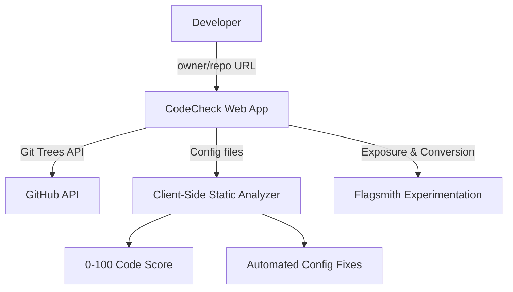

# CodeCheck

**Instant GitHub repository code quality, strictness, & CI scanner with live Flagsmith experimentation.**

## Live Demo

👉 **Try CodeCheck live:** [https://codecheck-opal.vercel.app](https://codecheck-opal.vercel.app)

> Test any public GitHub repository (e.g. `facebook/react`), deep-link with `?repo=owner/repo`, or try the built-in sample repositories in 1 click. Zero signup or database required.

---

## Overview

CodeCheck evaluates public GitHub repositories across 8 launch-critical checks:
- Automated CI/CD Pipeline
- Strict Type Safety
- Automated Test Suite Setup
- Linter & Code Formatter
- Secret Protection & .gitignore
- Dependency Audits & Lockfiles
- Source Modularity & Architecture
- Code Hygiene & Error Boundaries

---

## Architecture



---

## Live Flagsmith Experiment

- **Feature Flag:** `code_fix_workflow_mode`
- **Control Arm:** Static diagnostic code quality checklist
- **Treatment Arm:** Inline ready-to-copy configuration files (`.github/workflows/ci.yml`, `tsconfig.json`, `biome.json`, `.github/dependabot.yml`, `.gitignore`)
- **Primary Metric:** `code_fix_applied` (occurrence, direction: up)
- **Traffic Split:** 100% rollout, 50 / 50 allocation

---

## Tech Stack & Prerequisites

| Layer | Technology |
| :--- | :--- |
| **Frontend** | React 19 + TypeScript + Vite |
| **Styling** | Tailwind CSS v4 |
| **Experimentation** | Flagsmith JS SDK v12.4 |
| **Hosting** | Vercel Static Hosting |

**Prerequisites:** Node.js 20+

---

## Quickstart

```bash
# Clone and run locally
git clone https://github.com/akashgamerz6575-spec/codecheck.git
cd codecheck

# Install dependencies
npm install

# Configure environment
cp .env.example .env

# Run dev server
npm run dev
```

---

## Environment Variables

| Variable | Description | Required |
| :--- | :--- | :--- |
| `VITE_FLAGSMITH_ENV_KEY` | Flagsmith client-side environment SDK key | Yes |

---

## Usage

Scan any repository directly in the browser or share a pre-loaded link:

```bash
# Deep-link to any public repository
https://codecheck-opal.vercel.app/?repo=owner/repo

# Or run with npx (preview CLI)
npx codecheck owner/repo
```

---

## Contributing

Contributions are welcome! Please follow these steps:
1. Fork the repo and create a feature branch: `git checkout -b feat/improvement`
2. Install dependencies: `npm install`
3. Run tests and verify the build: `npm run build`
4. Submit a pull request. See [CONTRIBUTING.md](./CONTRIBUTING.md) for full details.

---

## License

MIT © 2026 CodeCheck Contributors. See [LICENSE](./LICENSE).
